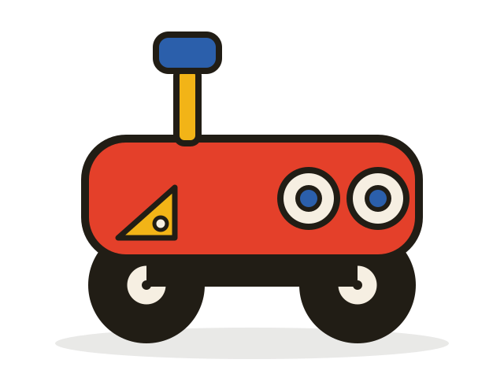

# horaceTheCheese 🧀

**A WAVE ROVER × ROS 2 project — a little rover that maps the world.**

<p align="center">
  
</p>

[](https://palolz.github.io/horaceTheCheese/)
[](https://github.com/palolz/horaceTheCheese/actions/workflows/deploy.yml)
[](https://docs.ros.org/en/jazzy/)

horaceTheCheese is a documented robotics build: a [Waveshare WAVE ROVER](https://www.waveshare.com/wiki/WAVE_ROVER) 4WD chassis, a ROS 2 Jazzy control stack, an LD19 LiDAR, and a binocular depth camera — all the way from first motor spin to full SLAM and autonomy. The ESP32 onboard stays on its stock firmware and is used purely for motor control; everything else runs in ROS 2 on an onboard host board, with a Mac watching over WiFi.

📖 **Full documentation, stage notes, and build log: [palolz.github.io/horaceTheCheese](https://palolz.github.io/horaceTheCheese/)**

## The six-stage roadmap

| # | Stage | Status | What "done" looks like |
| --- | --- | --- | --- |
| 1 | **Chassis & motor control** | **Done** | ROS 2 ↔ ESP32 JSON bridge (`wave_rover_base`) over Wi-Fi HTTP & UART; `HORACE LIVES` OLED & keyboard teleop verified |
| 2 | **LiDAR bring-up** | Next up (D500 on bench) | LDROBOT D500 (LD19) publishing `/scan`; first 2D map with `slam_toolbox` |
| 3 | **Binocular depth** | Planned | Stereo camera streaming depth images + point clouds over WiFi |
| 4 | **Sensor fusion** | Planned | `robot_localization` EKF fusing IMU + wheel odometry, drift measured and tamed |
| 5 | **Full SLAM** | Planned | RTAB-Map fusing LiDAR + vision into a persistent, loop-closing map |
| 6 | **Autonomy** | Planned | Nav2 goal following: click the map, the rover drives there |

## Quickstart: Drive Horace right now (Stage 1)

1. **Join the rover's Wi-Fi AP** (`UGV`, password `12345678`, rover IP `192.168.4.1`) or connect USB/UART serial (`115200` baud).
2. **Build & launch `wave_rover_base`** in one terminal:
   ```bash
   source /opt/homebrew/Caskroom/miniforge/base/etc/profile.d/conda.sh
   conda activate ros_jazzy
   cd ros2
   colcon build
   source install/setup.bash
   ros2 launch wave_rover_bringup rover.launch.py transport:=http host:=192.168.4.1
   ```
3. **Run keyboard teleop** in a second terminal:
   ```bash
   source /opt/homebrew/Caskroom/miniforge/base/etc/profile.d/conda.sh
   conda activate ros_jazzy
   ros2 run teleop_twist_keyboard teleop_twist_keyboard
   ```
4. **Or send raw HTTP JSON smoke-test commands** with `curl`:
   ```bash
   curl --globoff 'http://192.168.4.1/js?json={"T":3,"lineNum":0,"Text":"HORACE LIVES"}'
   curl --globoff 'http://192.168.4.1/js?json={"T":1,"L":0.25,"R":0.25}'
   curl --globoff 'http://192.168.4.1/js?json={"T":1,"L":0,"R":0}'
   curl --globoff 'http://192.168.4.1/js?json={"T":-3}'
   ```

## Repo layout

```
docs/   MkDocs documentation site + hardware photos (the GitHub Pages source)
ros2/   ROS 2 Jazzy workspace (wave_rover_base + wave_rover_bringup)
```

## Design language

Simple, elegant, primary colors, retro — like a late seventies toy. Warm cream `#F6EFE2`, soft-black ink `#211D15`, red `#E4402A`, blue `#2B5FAB`, yellow `#F2B417`. Fredoka for headings, Space Grotesk for body, Space Mono for labels.
