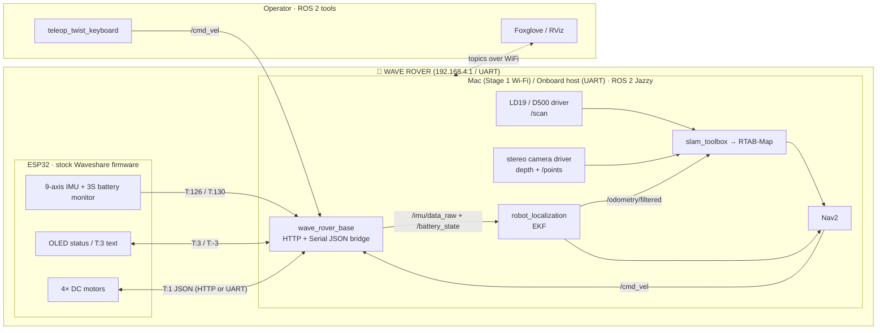
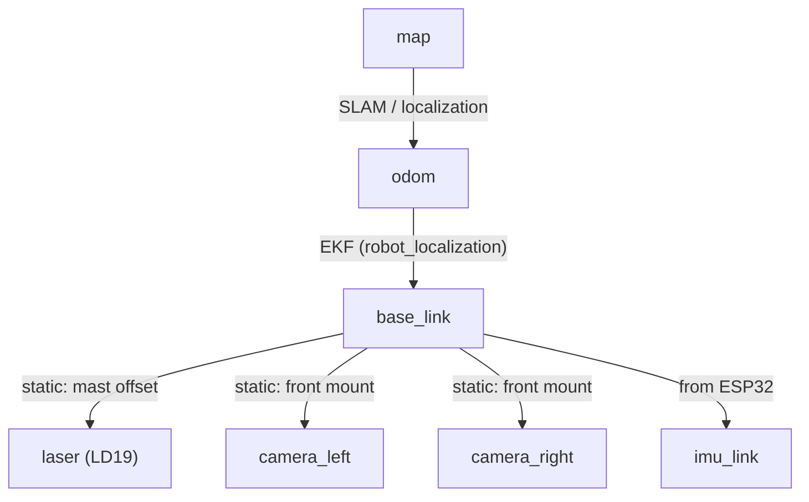

# Architecture

Three computers, three jobs. The ESP32 drives motors and reads the IMU. The onboard host board runs the ROS 2 stack. The Mac watches, visualizes, and occasionally shouts `cmd_vel` over WiFi.

## System overview

## Frame tree (tf2)

A classic REP-105 tree. `map` is the SLAM-anchored world frame; `odom` drifts smoothly; `base_link` is the rover; sensors hang off it with measured static transforms.

## Design rules

- **The ESP32 is a motor controller, nothing more.** Stock firmware, JSON commands in, telemetry out. No re-flashing unless a stage truly needs it.
- **All smarts live in ROS 2 Jazzy** on the onboard host board: drivers, EKF, SLAM, Nav2.
- **The Mac is a spectator with a remote.** Visualization and teleop over WiFi; the rover must keep doing sensible things if WiFi drops.
- **Frames are measured, not guessed.** Every `static_transform` in `wave_rover_description` comes off a ruler or calipers.
