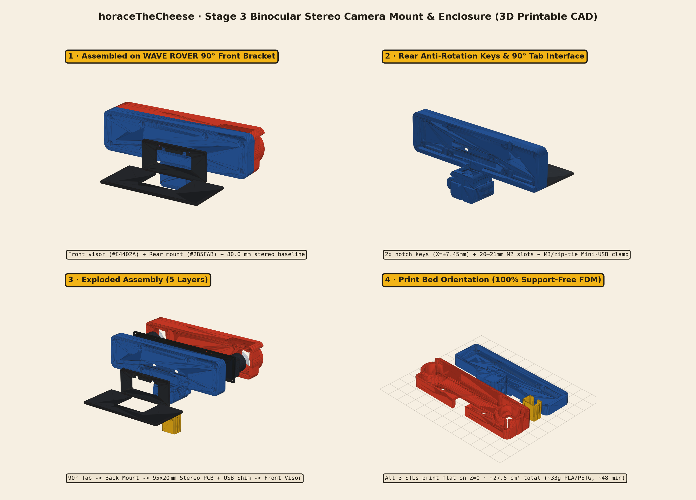

# Build log

Reverse-chronological diary of the build. Newest entry on top.

---

## 2026-11-04 — Stage 3 CAD: 3D-printable stereo camera enclosure, anti-rotation bracket & Mini-USB clamp CAD ready

Measured the binocular stereo camera module and the WAVE ROVER expansion plate's 90° upturned front bracket on the 5×5 mm cutting mat, cross-checked against the factory `WAVE_ROVER-EP_DXF` drawing, and generated a 3-piece support-free 3D-printable enclosure + Mini-USB strain-relief mount in `cad/camera_mount/`.

  <figure class="htc-photo">
    
    <figcaption>Measuring the <code>95.0 × 20.0 mm</code> stereo camera PCB on the 5×5 mm grid: <strong>80.0 mm lens baseline</strong>, 12× M2 holes, exposed FFC ribbons, and centered bottom Mini-USB receptacle.</figcaption>
  </figure>
  <figure class="htc-photo">
    
    <figcaption>Looking down the 90° upturned front bracket: two M2 holes (~20–21 mm C-to-C) and two inner "half-square" notches at <code>X = ±7.45 mm</code>.</figcaption>
  </figure>

**What happened:**

- **Extracted exact hardware & bracket dimensions:**
    - **Stereo camera PCB (`P1044926`–`P1044928`):** `95.0 × 20.0 × 1.6 mm` board, **`80.0 mm` center-to-center lens baseline** (`X = ±40.0 mm`), `14.0 × 14.0 mm` M12 lens bases (`19.0 mm` total height with caps), `92.0 × 17.0 mm` outer M2 mounting holes (`X = ±46.0 mm, Y = ±8.5 mm`), inner ribbon-flanking M2 holes at `X = ±26.1 mm` and `±22.1 mm`, and a centered bottom Mini-USB receptacle (`X = 0.0 mm`).
    - **WAVE ROVER 90° upturned front tab (`WAVE ROVER-EP DXF.dxf` + `P1044916`):** `44.88 mm` wide × `19.63 mm` tall × `2.00 mm` thick, `4.22 mm` top crossbar over a `25.75 × 8.10 mm` central U-window, two `Ø 2.2–2.3 mm` mounting holes at `20.0–21.0 mm` spacing, and two `3.12 mm`-wide inner square notches centered at `X = ±7.45 mm`.
- **Generated 3 watertight, support-free STL parts (`cad/camera_mount/generate_camera_mount.py`):**
    - [`horace_cam_back_mount.stl`](assets/cad/horace_cam_back_mount.stl) (`101.0 × 42.0 × 17.8 mm`, `14.45 cm³`): cradles the PCB on 8× M2 bosses with a recessed SMD cavity, hooks over the 90° tab with **two `2.70 × 3.0 × 2.10 mm` anti-rotation keys** that lock into the metal tab's inner square notches plus `3.5 × 2.4 mm` stadium M2 slots (`20.0–21.0 mm` C-to-C) with captive nut traps, and extends a **Mini-USB strain-relief clamp collar** below the port (`13.0 × 9.0 mm` max bay with M3 pinch bolt, hex nut trap, and `4.2 mm` zip-tie channel).
    - [`horace_cam_front_visor.stl`](assets/cad/horace_cam_front_visor.stl) (`102.0 × 26.0 × 14.5 mm`, `12.50 cm³`): retro binocular front cover shielding the fragile FFC ribbon cables while leaving `Ø 16.6 mm` openings for the lens barrels/caps beneath a sculpted top sun-visor brow.
    - [`horace_cam_usb_shim.stl`](assets/cad/horace_cam_usb_shim.stl) (`13.7 × 8.7 × 14.0 mm`, `0.67 cm³`): parametric snap-in Mini-USB plug collar insert (`10.2 × 7.0 mm` default overmold pocket + `Ø 4.5 mm` cable neck) that reprints in 2 minutes once the user's exact Mini-USB plug is measured.

**Next up:** Slice and print the 3 STLs flat on `Z = 0` (zero supports), bolt the camera onto the 90° front tab, and bring up the Stage 2 LDROBOT D500 LiDAR + Stage 3 stereo depth node.

---

## 2026-11-04 — Stage 1 bring-up: `HORACE LIVES` & first wheel spin Done

Horace is officially alive, talking to ROS 2 Jazzy, and spinning all four wheels on command.

  <figure class="htc-photo">
    
    <figcaption>Horace on the bench with its metal mounting deck and the LDROBOT D500 LiDAR Kit box ready in the background.</figcaption>
  </figure>
  <figure class="htc-photo">
    
    <figcaption>Mystery solved: newer Waveshare firmware boots SSID <code>UGV</code> (not <code>WAVE_ROVER</code>), showing <code>V:12.39</code> on the 3S pack.</figcaption>
  </figure>

**What happened:**

- **ROS 2 Jazzy on Apple Silicon:** Installed Miniforge + RoboStack (`robostack-jazzy`) natively on `osx-arm64` (`ros-jazzy-ros-base`, `ros-jazzy-teleop-twist-keyboard`, `colcon-common-extensions`).
- **Cracked the Wi-Fi SSID Plot Twist:** Scanning for `WAVE_ROVER` came up empty because newer General Driver for Robots firmware broadcasts **`AP:UGV`** (`192.168.4.1`, MAC `XX:XX:XX:XX:XX:XX`, battery `12.39 V`), which was right there on the OLED the whole time.
- **Verified HTTP JSON Control & First Motion:**
    - Sent `GET http://192.168.4.1/js?json={"T":3,"lineNum":0,"Text":"HORACE LIVES"}` → `HTTP/1.1 200 OK` and printed `HORACE LIVES` across line 0 of the OLED.
    - Sent `{"T":1,"L":0.25,"R":0.25}` → spun both left and right wheel pairs forward smoothly, followed by `{"T":1,"L":0,"R":0}` to stop and `{"T":-3}` to restore the status OLED.
- **Documented the UniFi Wi-Fi 7 (`T:404`) Gotcha:** The ESP32's 2.4 GHz radio won't associate with a WPA3 / PMF-enabled Wi-Fi 7 SSID; station mode requires a 2.4 GHz WPA2-PSK SSID with PMF disabled.
- **Built `wave_rover_base` + `wave_rover_bringup`:** Implemented the dual-transport (`transport:=http` and `transport:=serial`) ROS 2 bridge in `ros2/src/`, complete with a 10 Hz heartbeat stream (keeping the ESP32's 3-second watchdog alive), a 0.5 s `/cmd_vel` watchdog auto-stop, `T:126` / `T:130` telemetry polling, and `T:3` / `T:-3` OLED control, verified against an automated mock-ESP32 HTTP test suite.

**Next up:** Stage 2 — unboxing that **LDROBOT D500 LiDAR Kit** sitting on the bench, bolting down the metal expansion plate, and streaming `/scan` into `slam_toolbox`.

---

## 2026-11-04 — The scaffold Done

The site you're reading is the first artifact of the project: a MkDocs Material build with a custom "late seventies toy" theme — cream paper, soft-black ink, primary red/blue/yellow, chunky borders, and hard offset shadows.

**What happened:**

- Scaffolded the full site: home, six stage pages, architecture, hardware/BOM, and this build log.
- Drew the brand artwork as flat SVG: the red rover with black wheels, binocular eyes, and a blue LiDAR on a yellow mast, plus the cheese-wedge mark.
- Wired Mermaid diagram support for the architecture pages.
- Set up GitHub Actions to deploy to GitHub Pages on every push to `main`.

**Next up:** stage 1 — the ESP32 serial bridge and first motor spins, as soon as the onboard host board lands.
