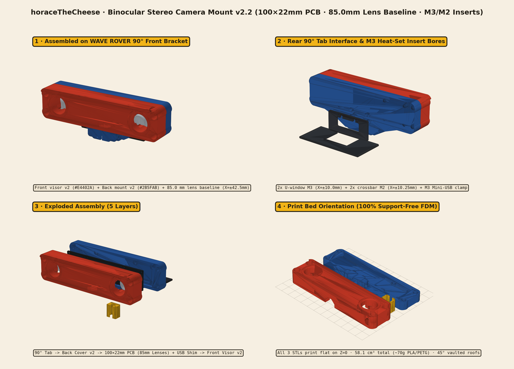

# Build log

Reverse-chronological diary of the build. Newest entry on top.

---

## 2026-11-20 — Stage 3 stereo camera mount v2.3: M3/M2 heat-set inserts, 85 mm baseline & Onshape fit refinements CAD v2.3 ready

Measured the binocular stereo camera module and the WAVE ROVER expansion plate's upturned 90° front bracket, iterated through Onshape fit checks, and finalized the **v2.3 support-free 3-part 3D-printable camera enclosure** around **M3 and M2 brass heat-set threaded inserts** ([Stage 3 CAD & drawings](stages/stage-3-depth.md)):

**What happened:**

- **Calibrated Board & Optics Geometry (`100.0 × 22.0 × 1.6 mm` PCB, `85.0 mm` Baseline):**
    - Sized the rear PCB cradle pocket to **`101.2 × 23.2 mm`** (`0.6 mm` clearance per side in X and Y) with a `98.0 × 18.0 × 1.4 mm` SMD clearance recess over a solid `5.4 mm` floor.
    - Positioned the two `Ø 16.6 mm` binocular lens turrets at **`85.0 mm` center-to-center (`X = ±42.5 mm, Y = 0.0 mm` = `11.0 mm` from the `22.0 mm` top/bottom edges and `7.5 mm` from the `100.0 mm` ends)** with `15.2 × 15.2 mm` internal square pockets and 45° conical roofs over the `14 × 14 × 6 mm` M12 lens bases.
- **Redesigned for M3 & M2 Brass Heat-Set Threaded Inserts (Zero Hex-Nut Pockets):**
    - **8× PCB M2 Insert Bosses (`Ø 3.2 × 4.5 mm` blind bores):** 4× at the outer board corners (**`96.0 × 18.0 mm`, `X = ±48.0, Y = ±9.0 mm`**) and 4× at the middle FFC-flanking holes (**`52.2 × 18.0 mm`, `X = ±26.1, Y = ±9.0 mm`**, 3rd hole from left/right) so the circuit board bolts directly to the Back Cover with M2 screws.
    - **4× Outer M3 Casing Fastening Ears (`113.0 × 18.0 mm`, `X = ±56.5, Y = ±9.0 mm`):** Positioned completely outside the `101.2 mm` PCB pocket (`Ø 9.2 mm` boss OD, `Ø 4.0 × 6.5 mm` M3 insert bore on Back Cover, `Ø 3.4 mm` through + `Ø 6.5 mm` counterbore on Front Visor).
    - **Clean Front Faceplate + 8× Blind Screw-Head Pockets:** Removed the PCB screw holes from the Front Visor faceplate and carved 8× blind `Ø 4.8 × 2.8 mm` underside pockets (`4.2 mm` vertical head clearance above PCB).
- **Enlarged FFC Ribbon Crevice & Cut-Down Mini-USB Clamp (`0.000000 mm³` Interference):**
    - Expanded the Front Visor's internal vaulted FFC ribbon chamber to **`70.0 × 16.8 mm` wide** with **`12.8 mm` vertical clearance above the PCB front face** to protect the `10.0 mm` high × `13.0 mm` wide bowed ribbon cables without touching them.
    - Trimmed the raised Mini-USB clamp collar and M3 heat-set pinch jaws to **`Y ≤ -16.2 mm`** (`1.4 mm` clear of the Front Visor's `Y = -14.8 mm` bottom wall) and cut the USB neck channel down to `Z = 6.4 mm`.

---

## 2026-11-04 — Stage 1 bring-up: `HORACE LIVES` & first wheel spin Done

Horace is officially alive, talking to ROS 2 Jazzy, and spinning all four wheels on command.

  <figure class="htc-photo">
    
    <figcaption>Horace on the bench with its metal mounting deck and the LDROBOT D500 LiDAR Kit box ready in the background.</figcaption>
  </figure>
  <figure class="htc-photo">
    
    <figcaption>Mystery solved: newer Waveshare firmware boots SSID <code>UGV</code> (not <code>WAVE_ROVER</code>), showing <code>V:12.39</code> on the 3S pack.</figcaption>
  </figure>

**What happened:**

- **ROS 2 Jazzy on Apple Silicon:** Installed Miniforge + RoboStack (`robostack-jazzy`) natively on `osx-arm64` (`ros-jazzy-ros-base`, `ros-jazzy-teleop-twist-keyboard`, `colcon-common-extensions`).
- **Cracked the Wi-Fi SSID Plot Twist:** Scanning for `WAVE_ROVER` came up empty because newer General Driver for Robots firmware broadcasts **`AP:UGV`** (`192.168.4.1`, MAC `XX:XX:XX:XX:XX:XX`, battery `12.39 V`), which was right there on the OLED the whole time.
- **Verified HTTP JSON Control & First Motion:**
    - Sent `GET http://192.168.4.1/js?json={"T":3,"lineNum":0,"Text":"HORACE LIVES"}` → `HTTP/1.1 200 OK` and printed `HORACE LIVES` across line 0 of the OLED.
    - Sent `{"T":1,"L":0.25,"R":0.25}` → spun both left and right wheel pairs forward smoothly, followed by `{"T":1,"L":0,"R":0}` to stop and `{"T":-3}` to restore the status OLED.
- **Documented the UniFi Wi-Fi 7 (`T:404`) Gotcha:** The ESP32's 2.4 GHz radio won't associate with a WPA3 / PMF-enabled Wi-Fi 7 SSID; station mode requires a 2.4 GHz WPA2-PSK SSID with PMF disabled.
- **Built `wave_rover_base` + `wave_rover_bringup`:** Implemented the dual-transport (`transport:=http` and `transport:=serial`) ROS 2 bridge in `ros2/src/`, complete with a 10 Hz heartbeat stream (keeping the ESP32's 3-second watchdog alive), a 0.5 s `/cmd_vel` watchdog auto-stop, `T:126` / `T:130` telemetry polling, and `T:3` / `T:-3` OLED control, verified against an automated mock-ESP32 HTTP test suite.

**Next up:** Stage 2 — unboxing that **LDROBOT D500 LiDAR Kit** sitting on the bench, bolting down the metal expansion plate, and streaming `/scan` into `slam_toolbox`.

---

## 2026-11-04 — The scaffold Done

The site you're reading is the first artifact of the project: a MkDocs Material build with a custom "late seventies toy" theme — cream paper, soft-black ink, primary red/blue/yellow, chunky borders, and hard offset shadows.

**What happened:**

- Scaffolded the full site: home, six stage pages, architecture, hardware/BOM, and this build log.
- Drew the brand artwork as flat SVG: the red rover with black wheels, binocular eyes, and a blue LiDAR on a yellow mast, plus the cheese-wedge mark.
- Wired Mermaid diagram support for the architecture pages.
- Set up GitHub Actions to deploy to GitHub Pages on every push to `main`.

**Next up:** stage 1 — the ESP32 serial bridge and first motor spins, as soon as the onboard host board lands.
