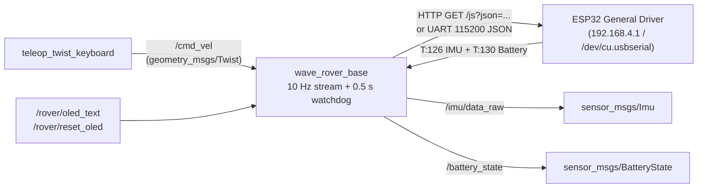

# Stage 1 · Chassis & motor control <span class="htc-badge htc-badge--done">Done</span>

Get the WAVE ROVER driving under ROS 2 Jazzy. The onboard ESP32 keeps its stock Waveshare firmware and stays purely in charge of motor control, OLED status, and IMU readout; our `wave_rover_base` node speaks JSON to it over **Wi-Fi HTTP** (`GET http://192.168.4.1/js?json=...`) right from the Mac today, and over **3.3 V UART / USB serial** (`115200` baud) when an onboard companion board is bolted to the deck.

<div class="htc-photo-grid">
  <figure class="htc-photo">
    
    <figcaption>Horace on the cutting mat with the metal expansion deck plate and the LDROBOT D500 LiDAR Kit box waiting for Stage 2.</figcaption>
  </figure>
  <figure class="htc-photo">
    
    <figcaption>First boot OLED readout: <code>AP:UGV</code>, <code>ST: OFF</code>, <code>MAC:XX:XX:XX:XX:XX:XX</code>, battery at a healthy <code>V:12.39</code>.</figcaption>
  </figure>
</div>

## Goals

- [x] Native `osx-arm64` ROS 2 Jazzy installed on the Mac via Miniforge + RoboStack (`ros-jazzy-ros-base`, `teleop-twist-keyboard`, `colcon`)
- [x] Joined the rover's Wi-Fi access point (`UGV` → `192.168.4.1`) and verified live HTTP JSON control (`HORACE LIVES` on the OLED + 4WD wheel spin)
- [x] `wave_rover_base` ROS 2 package supporting both `transport:=http` and `transport:=serial` (`115200` baud newline-delimited JSON)
- [x] `/cmd_vel` (`geometry_msgs/Twist`) → `{"T":1,"L":...,"R":...}` differential drive with 10 Hz heartbeat stream (keeping the ESP32's 3-second watchdog happy) and 0.5 s ROS watchdog auto-stop
- [x] Telemetry poller (`{"T":126}` IMU + `{"T":130}` battery voltage) publishing `/imu/data_raw` and `/battery_state`, plus OLED text control (`T:3` / `T:-3`)
- [x] End-to-end verification against both the physical rover and a local mock ESP32 HTTP server test suite

---

## 1 · ROS 2 Jazzy on macOS (`osx-arm64`) via RoboStack

Because the Mac talks directly to the rover over Wi-Fi (and USB serial on the bench), we run ROS 2 Jazzy natively on Apple Silicon using [RoboStack](https://robostack.github.io/) rather than inside a VM or container:

```bash
# 1. Install Miniforge (Apple Silicon)
brew install --cask miniforge

# 2. Create a clean Python 3.11 environment wired to robostack-jazzy
source /opt/homebrew/Caskroom/miniforge/base/etc/profile.d/conda.sh
conda create -y -n ros_jazzy python=3.11
conda activate ros_jazzy
conda config --env --add channels conda-forge
conda config --env --add channels robostack-jazzy
conda config --env --set channel_priority strict

# 3. Install ROS 2 Jazzy base, keyboard teleop, colcon, and pyserial
conda install -y ros-jazzy-ros-base ros-jazzy-teleop-twist-keyboard colcon-common-extensions
pip install pyserial "pytest<8.2"
```

---

## 2 · Connecting to the rover (`AP: UGV`)

Older Waveshare documentation lists the default hotspot SSID as `WAVE_ROVER`, but newer General Driver for Robots firmware boots its own 2.4 GHz access point named **`UGV`** (shown right on line 0 of the OLED):

| Parameter | Value on Horace |
| --- | --- |
| **AP SSID** | `UGV` |
| **AP Password** | `12345678` |
| **Rover IP (AP mode)** | `192.168.4.1` |
| **MAC Address** | `XX:XX:XX:XX:XX:XX` |
| **Battery (3S 18650)** | `12.39 V` (full charge) |

!!! warning "Why `T:404` home Wi-Fi (STA mode) fails on UniFi Wi-Fi 7"
    The ESP32 supports joining an existing LAN via `{"T":404,"ssid":"YourSSID","password":"YourPassword"}` followed by `{"T":401,"mode":3}` (AP+STA). However, on a modern **UniFi Wi-Fi 7** network with WPA3 / 6 GHz / Protected Management Frames (PMF), the ESP32's 2.4 GHz 802.11b/g/n radio silently refuses to associate (`ST: OFF`).

    **The fix when using STA mode:** point `T:404` at a dedicated **2.4 GHz-only IoT SSID** configured for **WPA2-PSK** with **PMF Disabled** (and band steering / BSS transition off). Until then, direct connection to the `UGV` AP at `192.168.4.1` works out of the box with zero router latency.

---

## 3 · Live hardware smoke test (`HORACE LIVES`)

With the Mac joined to `UGV` (`192.168.4.1`), we verified the ESP32 HTTP JSON endpoint (`GET http://192.168.4.1/js?json=...`) step by step before letting a control loop near the motors:

```bash
# 1. Write custom text to OLED line 0 -> HTTP/1.1 200 OK
curl --globoff 'http://192.168.4.1/js?json={"T":3,"lineNum":0,"Text":"HORACE LIVES"}'

# 2. Gentle forward spin on all four wheels (25% speed = 0.25 in [-0.5, 0.5])
curl --globoff 'http://192.168.4.1/js?json={"T":1,"L":0.25,"R":0.25}'

# 3. Immediate motor stop
curl --globoff 'http://192.168.4.1/js?json={"T":1,"L":0,"R":0}'

# 4. Restore the stock status screen on the OLED (AP / ST / MAC / V)
curl --globoff 'http://192.168.4.1/js?json={"T":-3}'
```

---

## 4 · `wave_rover_base` ROS 2 bridge architecture

The bridge package (`ros2/src/wave_rover_base`) keeps all Waveshare protocol quirks in one small, testable Python node and exposes standard ROS 2 interfaces:



### Key safety & hardware details

1. **10 Hz command stream vs. ESP32 3-second heartbeat:** The Waveshare firmware stops the motors automatically if ~3 seconds pass without a new `T:1` packet. While a non-zero `/cmd_vel` is active, `wave_rover_base` streams `{"T":1,"L":...,"R":...}` at **10 Hz** so steady keyboard holds don't stutter.
2. **0.5 s ROS `/cmd_vel` watchdog:** If the teleop or navigation node stops publishing `/cmd_vel` for more than **0.5 s** (or when `wave_rover_base` shuts down), the node immediately sends `{"T":1,"L":0,"R":0}` so Horace never coasts unattended.
3. **Dual transport (`http` and `serial`):** Switch between Wi-Fi HTTP and onboard 3.3 V UART (`5V / GND / RX / TX` silkscreened right on the top deck) with a single launch argument.

<div class="htc-photo-grid">
  <figure class="htc-photo">
    
    <figcaption>Top deck detail: smoked acrylic window over the ESP32 General Driver for Robots board and the silkscreened 40-pin header (<code>5V / GND / RX / TX / SCL / SDA</code>) ready for direct UART wiring.</figcaption>
  </figure>
  <figure class="htc-photo">
    
    <figcaption>Workbench lineup: Horace beside the Raspberry Pi Zero-form-factor board and the LDROBOT D500 LiDAR kit.</figcaption>
  </figure>
</div>

---

## 5 · Build & drive quickstart

```bash
# 1. Activate the ROS 2 Jazzy environment and build the workspace
source /opt/homebrew/Caskroom/miniforge/base/etc/profile.d/conda.sh
conda activate ros_jazzy
cd ros2
colcon build
source install/setup.bash

# 2. Terminal 1 — Launch the WAVE ROVER bridge (HTTP mode over UGV Wi-Fi AP)
ros2 launch wave_rover_bringup rover.launch.py transport:=http host:=192.168.4.1

#    (Or over USB/UART serial at 115200 baud)
# ros2 launch wave_rover_bringup rover.launch.py transport:=serial port:=/dev/cu.usbserial-0001 baudrate:=115200

# 3. Terminal 2 — Drive Horace with the keyboard (i=forward, j/l=turn, k=stop)
ros2 run teleop_twist_keyboard teleop_twist_keyboard
```

### Useful runtime commands

```bash
# Write a custom banner to the rover's OLED screen at runtime
ros2 topic pub --once /rover/oled_text std_msgs/msg/String "{data: '0:HORACE LIVES'}"

# Restore the default OLED status screen (AP / ST / MAC / V)
ros2 service call /rover/reset_oled std_srvs/srv/Trigger "{}"

# Trigger an immediate emergency stop
ros2 service call /rover/emergency_stop std_srvs/srv/Trigger "{}"

# Run the automated mock-ESP32 end-to-end test suite (no rover Wi-Fi required)
pytest src/wave_rover_base/test/test_protocol_and_http.py -v
```

