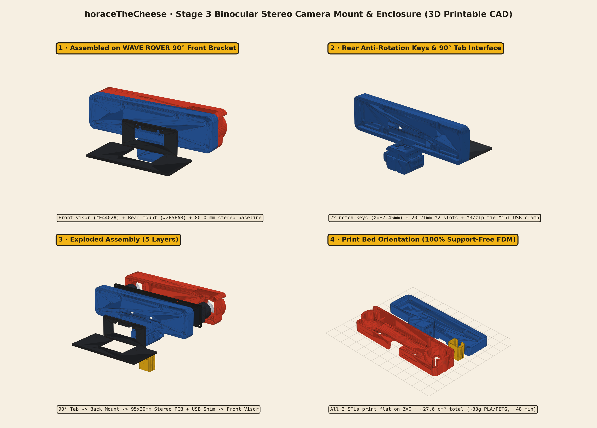
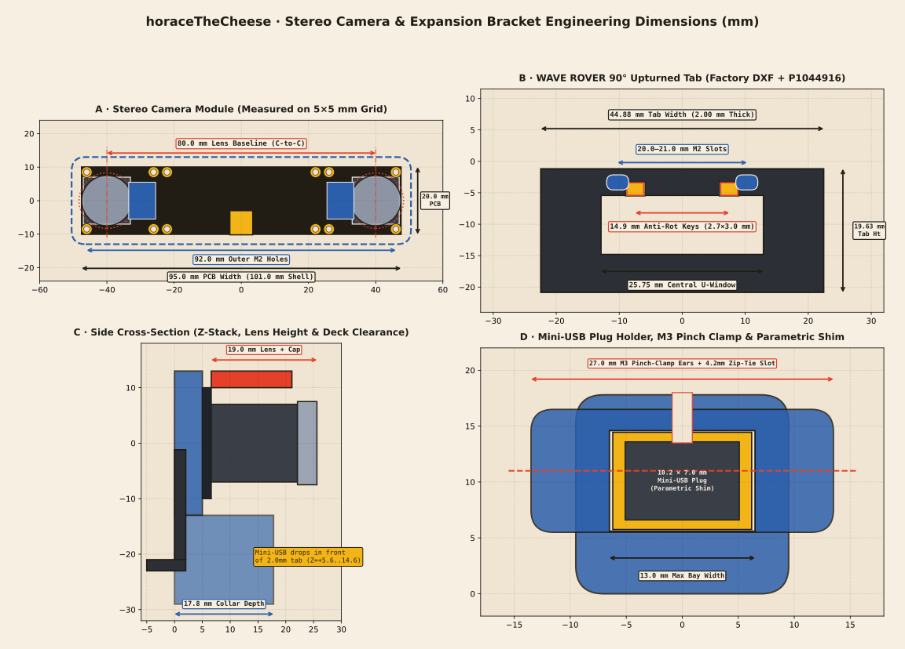
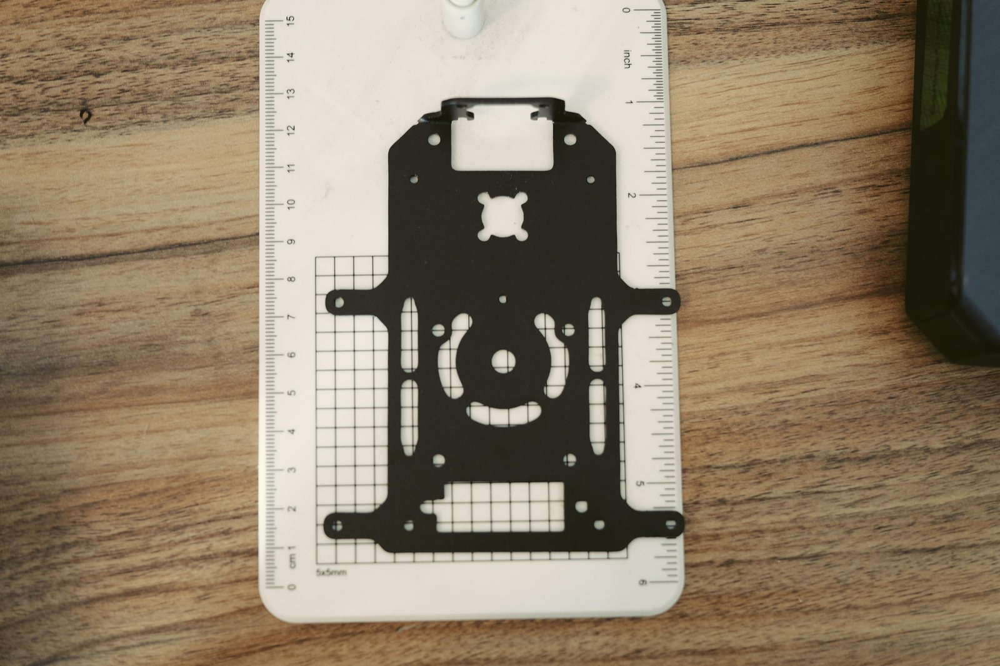
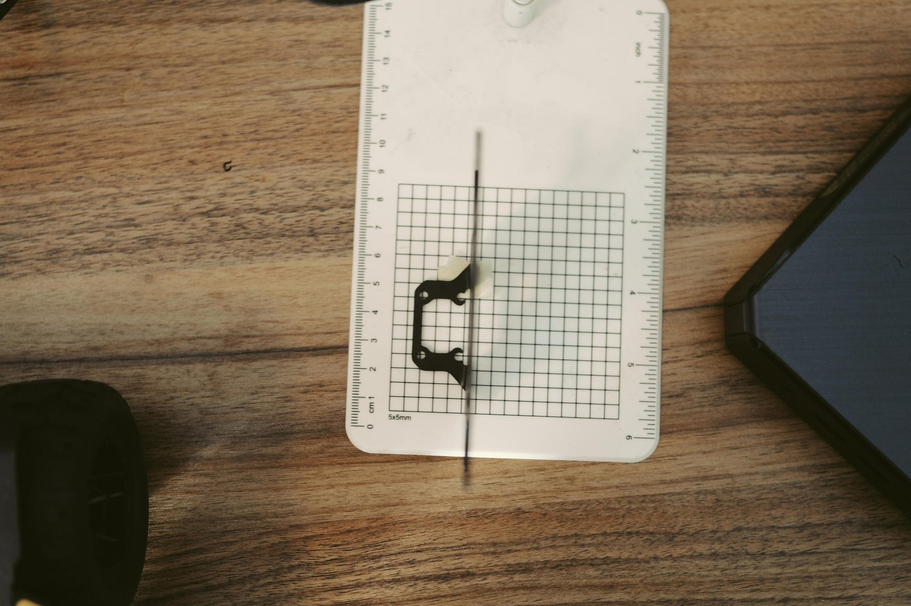
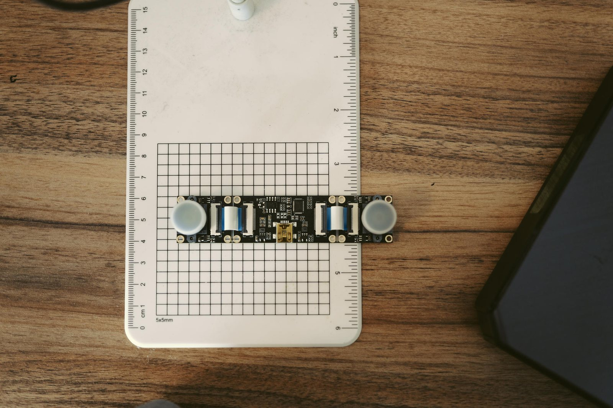
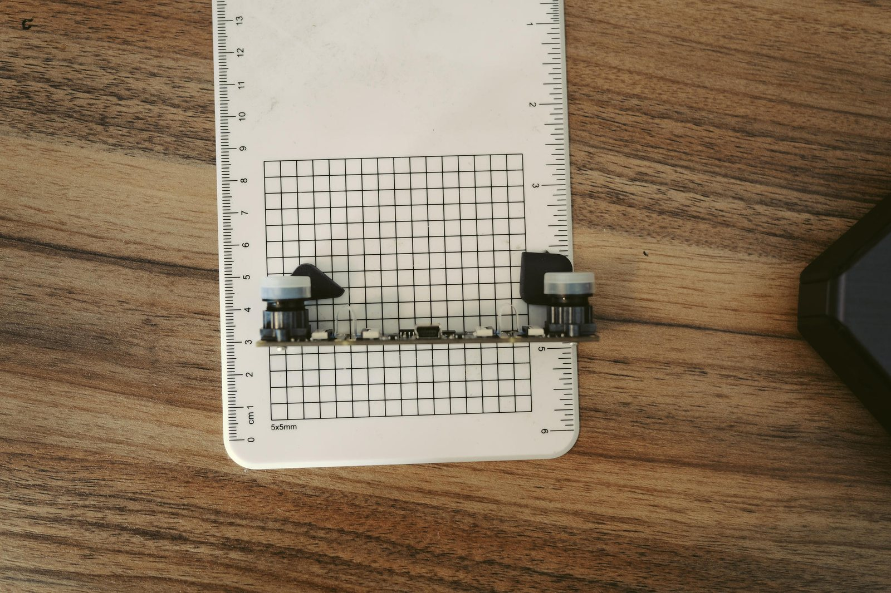
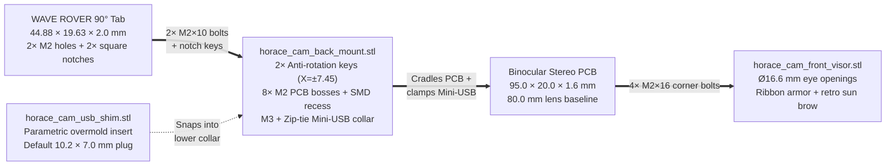

# Stage 3 · Binocular depth <span class="htc-badge htc-badge--progress">In progress · CAD ready</span>

Give horace its eyes: a binocular (stereo) camera (`95.0 × 20.0 mm` PCB, **80.0 mm** stereo baseline) computing depth and streaming rectified stereo / point clouds, housed in a custom 3D-printable retro visor mount bolted to the upturned 90° front tab of the WAVE ROVER expansion plate.

## Goals

- [x] Measure the stereo camera PCB (`95.0 × 20.0 mm`, **80.0 mm** lens baseline) and the WAVE ROVER 90° upturned front bracket (from factory DXF + 5×5 mm grid photos)
- [x] Design support-free 3D-printable stereo camera enclosure (`horace_cam_back_mount.stl` + `horace_cam_front_visor.stl`) with anti-rotation notch keys and Mini-USB strain-relief clamp (`horace_cam_usb_shim.stl`)
- [ ] Print the 3-piece camera housing, bolt to the 90° front tab, and verify Mini-USB plug retention
- [ ] Camera driver publishing rectified left/right images, camera info, and a depth image
- [ ] `depth_image_proc` producing a colored point cloud on `/points`
- [ ] Streams viewable live in Foxglove / RViz on the Mac over WiFi

---

## 3D-printable stereo camera enclosure & mount (`cad/camera_mount/`)

The WAVE ROVER's black anodized metal expansion plate features a **90° upturned front tab** (`44.88 mm` wide × `19.63 mm` tall above the top deck, `2.00 mm` thick) with two mounting holes (`~20.0–21.0 mm` center-to-center) and two distinctive **"half-square" notches** on the inside edge of its top crossbar. Meanwhile, the binocular stereo camera module is a **`95.0 × 20.0 × 1.6 mm` PCB** with two M12 lens barrels at an **`80.0 mm` center-to-center baseline**, exposed FFC ribbon jumpers on the front face, and a downward-facing **Mini-USB receptacle** dead-center on the bottom edge (`X = 0.0 mm`).

To protect the exposed ribbons, lock the camera rigidly against rover vibration, and keep the Mini-USB connector from wiggling loose, we designed a **three-part, 100% support-free 3D-printable enclosure** in [`cad/camera_mount/`](https://github.com/palolz/horaceTheCheese/tree/main/cad/camera_mount):

<p>
  <a class="htc-btn htc-btn--red" href="../assets/cad/horace_cam_back_mount.stl" download>⬇ Back Mount + Clamp (.stl)</a>
  <a class="htc-btn" href="../assets/cad/horace_cam_front_visor.stl" download>⬇ Front Retro Visor (.stl)</a>
  <a class="htc-btn htc-btn--yellow" href="../assets/cad/horace_cam_usb_shim.stl" download>⬇ Mini-USB Shim (.stl)</a>
  <a class="htc-btn" href="../assets/cad/generate_camera_mount.py" download>⬇ Parametric Script (.py)</a>
</p>

| File | Dimensions (`X × Y × Z`) | Volume / Est. Mass | Role |
| --- | --- | --- | --- |
| [`horace_cam_back_mount.stl`](../assets/cad/horace_cam_back_mount.stl) | `101.0 × 42.0 × 17.8 mm` | `14.45 cm³` (~18 g) | Rear protective shell, 8× M2 PCB bosses, 90° bracket seat with **2× anti-rotation notch keys**, and **Mini-USB pinch-clamp + zip-tie collar** |
| [`horace_cam_front_visor.stl`](../assets/cad/horace_cam_front_visor.stl) | `102.0 × 26.0 × 14.5 mm` | `12.50 cm³` (~15 g) | Retro binocular front bezel with `Ø 16.6 mm` lens openings, ribbon-cable armor, top sun-visor brow, and 4× corner M2 counterbores |
| [`horace_cam_usb_shim.stl`](../assets/cad/horace_cam_usb_shim.stl) | `13.7 × 8.7 × 14.0 mm` | `0.67 cm³` (~1 g) | Quick-swap parametric U-collar insert sized for a `10.2 × 7.0 mm` Mini-USB overmold + `Ø 4.5 mm` cable neck (prints in 2 minutes) |



---

## Extracted dimensions (Factory DXF + 5×5 mm grid photogrammetry)

We cross-referenced the official Waveshare **`WAVE_ROVER-EP_DXF`** CAD drawing against sub-pixel measurements taken directly from the 5×5 mm grid cutting mat and steel millimeter ruler (`P1044915.JPG`–`P1044931.JPG`):



| Component / Feature | Measured Value | Source & Notes |
| --- | --- | --- |
| **Stereo PCB width × height × thickness** | **`95.0 × 20.0 × 1.6 mm`** | `P1044926` (ruler: `4.0` to `6.0 cm` = `20.0 mm` height) & `P1044927` (`19.0` grid squares = `95.0 mm` width). Pocket sized at `96.0 × 21.0 mm` (`0.5 mm` clearance per side). |
| **Stereo lens baseline (center-to-center)** | **`80.0 mm`** (`X = ±40.0 mm`) | Each `14.0 × 14.0 mm` M12 lens holder sits `0.5 mm` inset from the ends of the `95.0 mm` PCB (`95.0 - 2 × 7.5 = 80.0 mm`), confirmed on the 5×5 mm grid (`P1044927` & `P1044928`). |
| **M12 lens holder & barrel protrusion** | `14.0 × 14.0 mm` base, `Ø 14.0 mm` barrel (`Ø 15.0 mm` cap), **`19.0 mm`** total height above PCB | `P1044928` profile view. Front visor uses **`Ø 16.6 mm`** circular apertures so dust caps and focus rings turn freely while the `14×14 mm` square base stays captive inside. |
| **Outer corner M2 holes (4×)** | **`92.0 × 17.0 mm`** (`X = ±46.0 mm, Y = ±8.5 mm`), `Ø 2.0 mm` | `1.5 mm` inset from all 4 PCB edges (`P1044927`). Used as the 4 primary through-bolts clamping Front Visor → PCB → Back Mount. |
| **Inner FFC-flanking M2 holes (8×)** | **`X = ±26.1 mm`** (`52.2 mm`) & **`X = ±22.1 mm`** (`44.2 mm`), `Y = ±8.5 mm` | 4 pillars (`X = ±26.1 mm, Y = ±8.5 mm`) support the center of the PCB around the dual 24-pin MIPI/FFC ribbon connectors. |
| **Mini-USB receptacle position & size** | Centered at **`X = 0.0 mm`**, bottom edge (`6.8 mm` wide × `7.2 mm` deep × `3.9 mm` tall) | `P1044927` & `P1044928` (`+0.03 mm` from exact horizontal center). |
| **Expansion plate 90° front tab outer size** | **`44.88 mm` wide × `19.63 mm` tall × `2.00 mm` thick** | `WAVE ROVER-EP DXF.dxf` (`X = ±22.441 mm`, top crossbar `4.22 mm` tall above a `25.75 × 8.10 mm` central U-window). |
| **90° tab mounting holes (2×)** | **`Ø 2.2–2.3 mm`**, spaced **`20.0–21.0 mm`** C-to-C | `21.00 mm` (`X = ±10.50 mm`) in factory DXF; `~20.0 mm` (`25 mm` to `45 mm` grid lines) in `P1044916.JPG`. Back mount uses **`3.5 × 2.4 mm` stadium slots** centered at `X = ±10.25 mm` with captive M2 hex nut traps so both tolerances bolt right up. |
| **90° tab inner "half-square" notches (2×)** | **`3.12 mm` wide × `2.0 mm` tall** at **`X = ±7.45 mm`** (`±5.89..±9.01 mm`) | Flanking the `11.78 mm` center bridge on the inside edge of the top crossbar (`P1044916.JPG` + DXF). Matched by two **`2.70 × 3.0 × 2.10 mm` anti-rotation keys** on the back mount. |

### Workbench measurement reference photos (5×5 mm grid)

<div class="htc-photo-grid">
  <figure class="htc-photo">
    
    <figcaption><strong>Expansion plate (`P1044915`):</strong> Black anodized top deck on the 5×5 mm cutting mat with the 90° upturned camera bracket at the front.</figcaption>
  </figure>
  <figure class="htc-photo">
    
    <figcaption><strong>90° upturned front tab (`P1044916`):</strong> The two mounting holes at the 25 mm and 45 mm grid lines (~20–21 mm spacing) and the two inner "half-square" notches flanking the center bridge.</figcaption>
  </figure>
  <figure class="htc-photo">
    
    <figcaption><strong>Stereo camera front (`P1044927`):</strong> <code>95.0 × 20.0 mm</code> PCB, <code>80.0 mm</code> lens center-to-center baseline, exposed blue/white FFC ribbons, 12× M2 holes, and bottom-center Mini-USB port.</figcaption>
  </figure>
  <figure class="htc-photo">
    
    <figcaption><strong>Top-edge profile (`P1044928`):</strong> <code>1.6 mm</code> PCB, <code>14 × 14 mm</code> M12 lens holders, <code>19.0 mm</code> total lens + cap height, and rear SMD clearance.</figcaption>
  </figure>
</div>

---

## Mechanical design & Mini-USB strain relief



1. **Self-aligning 90° bracket interface with anti-rotation lugs:**
   - The rear of `horace_cam_back_mount.stl` features a `2.10 mm` deep recessed channel that hooks over the `4.22 mm` top crossbar of the upturned metal tab.
   - Immediately below that crossbar sit **two raised `2.70 × 3.0 × 2.10 mm` rectangular lugs** (`X = ±7.45 mm`) that drop into the metal tab's two "half-square" cutouts (`X = ±5.89..±9.01 mm`), locking roll and shear before you even tighten the two M2 screws.
   - The camera centerline is elevated **`+12.2 mm` above the top edge of the metal tab** (`+31.8 mm` above the expansion deck), giving `18.8 mm` of vertical clearance below the enclosure for the Mini-USB plug housing and cable bend radius.
2. **Triple-mode Mini-USB plug holder & strain relief:**
   - Because Mini-USB connectors are notorious for wiggling loose under 4WD skid-steer vibration, a `16.0 mm` tall U-shaped clamp tunnel extends directly beneath the bottom-center Mini-USB port (`X = 0.0 mm`).
   - Crucially, the PCB sits at `Z = +5.0..+6.6 mm` in front of the `2.0 mm` metal tab (`Z = 0.0..+2.0 mm`), so the downward Mini-USB plug (`Z = +5.6..+14.6 mm`) drops **cleanly in front of the metal bracket** without hitting the expansion deck.
   - The collar provides **three ways to lock any Mini-USB cable**:
     1. **Parametric snap-in shim (`horace_cam_usb_shim.stl`):** Sits inside the generous `13.0 × 9.0 mm` bay with side retention ribs (`13.7 mm` span) to hug a standard `10.2 × 7.0 mm` Mini-USB plug overmold and `Ø 4.5 mm` cable neck.
     2. **M3 pinch-clamp screw + captive hex nut trap:** Tighten a single `M3 × 16 mm` bolt across the `1.8 mm` front flex slit to squeeze the collar onto the plug.
     3. **Integrated `4.2 × 1.8 mm` zip-tie tunnel:** Wrap a standard `3.6 mm` nylon zip-tie around the collar waist for zero-hardware strain relief.
3. **Customizing the Mini-USB plug shim in 2 seconds:**
   Once you measure your specific Mini-USB cable's plastic plug overmold with calipers, you don't need to reprint the main mount — just regenerate and print the tiny `0.67 cm³` shim:
   ```bash
   /opt/homebrew/Caskroom/miniforge/base/envs/ros_jazzy/bin/python3 \
     cad/camera_mount/generate_camera_mount.py \
     --usb-plug-width 10.2 \
     --usb-plug-depth 7.0 \
     --usb-cable-dia 4.5
   ```
4. **100% support-free FDM printing:**
   All three STL files are already oriented with their flat build-plate face on **`Z = 0.0`**:
   - **Material:** PLA, Tough PLA, or PETG (classic primary blue `#2B5FAB` for the back mount, primary red `#E4402A` for the front visor, yellow `#F2B417` for the USB shim).
   - **Settings:** `0.20 mm` layer height, `0.4 mm` nozzle, 3 perimeters, 25% gyroid infill, **Supports: Disabled**.
   - **Hardware needed:** `2× M2 × 10 mm` screws + `2× M2` hex nuts (bracket to back mount), `4× M2 × 16 mm` screws + `4× M2` hex nuts (visor through PCB corners to back mount), and `1× M3 × 16 mm` screw + `M3` nut (or `1×` zip-tie) for the Mini-USB clamp.

---

## Next steps: ROS 2 stereo depth pipeline

1. Print `horace_cam_back_mount.stl`, `horace_cam_front_visor.stl`, and `horace_cam_usb_shim.stl`, bolt to the expansion plate's 90° front tab, and record the static transform `base_link → camera_link` (`x = +0.085 m, y = 0.0 m, z = +0.095 m`).
2. Calibrate the `80.0 mm` baseline stereo pair with `camera_calibration` and launch `image_proc` / `stereo_image_proc` + `depth_image_proc` to publish `/points`.
3. Verify live point clouds in Foxglove / RViz over Wi-Fi while driving via `wave_rover_base`.

