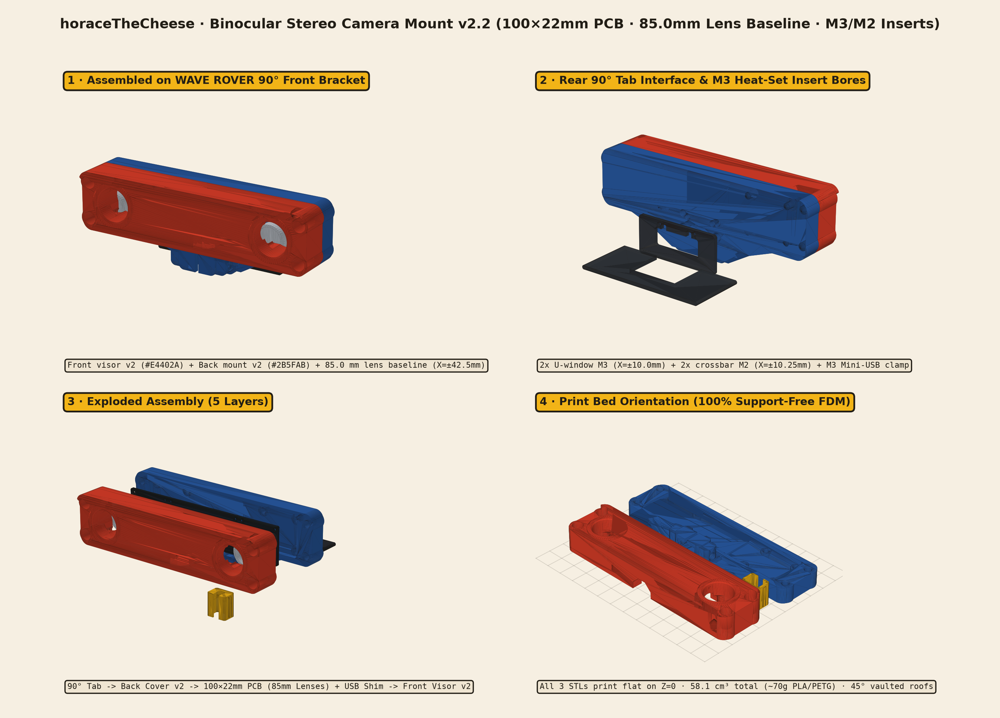
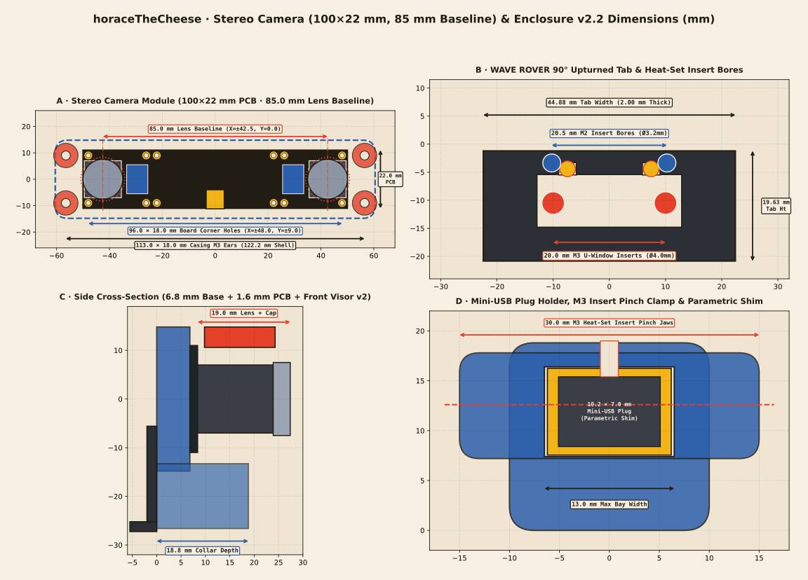
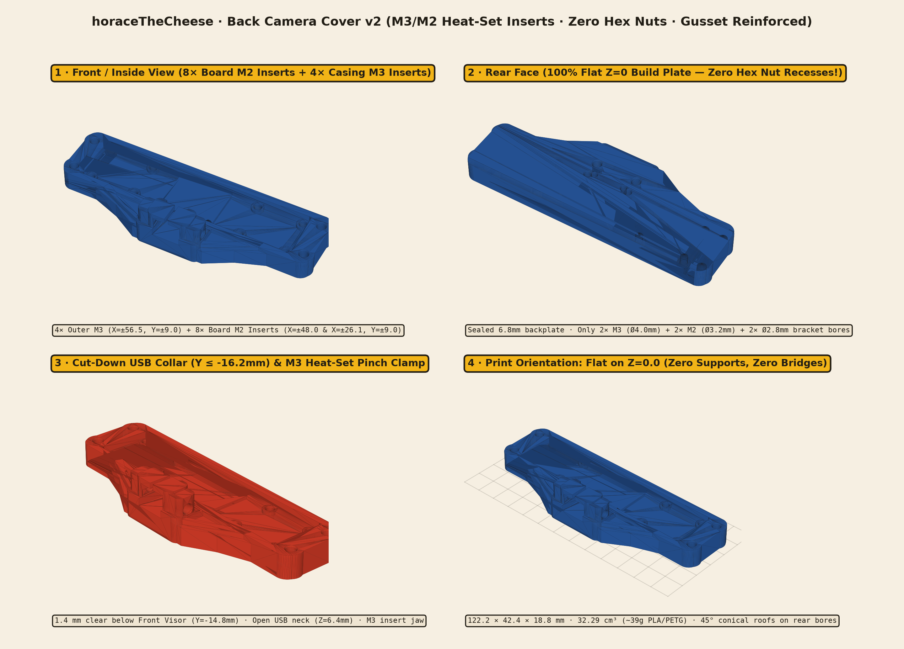
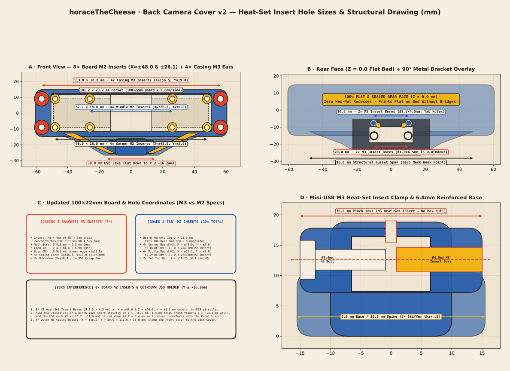
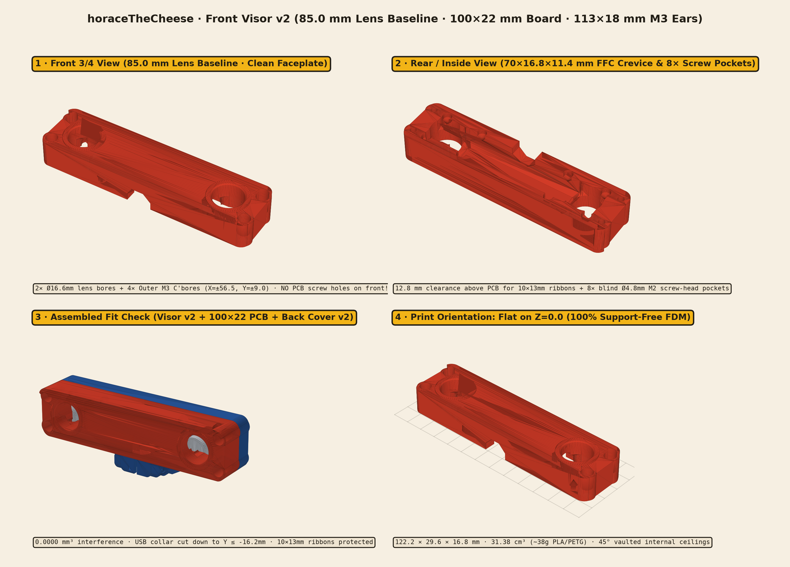
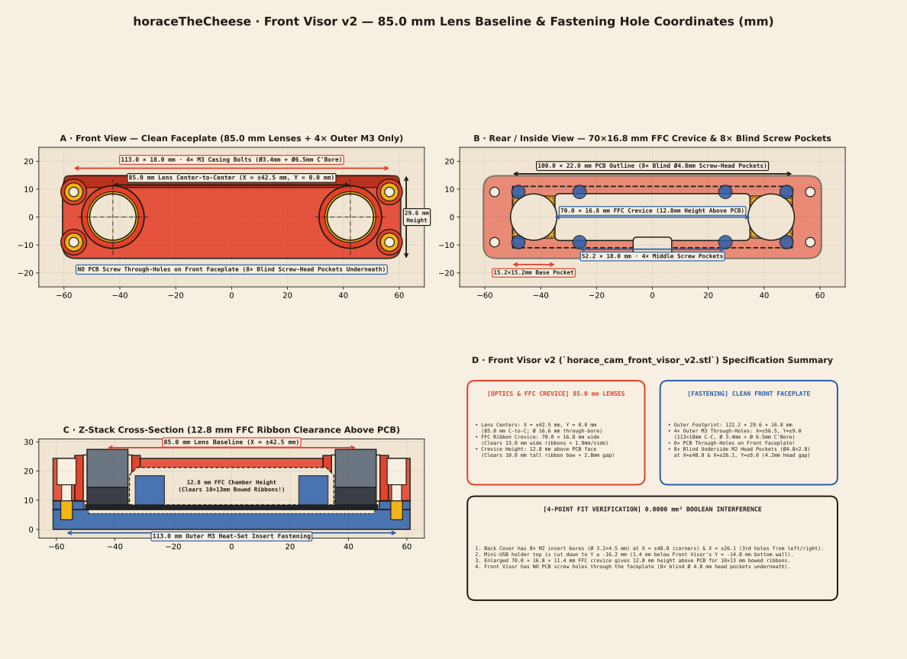
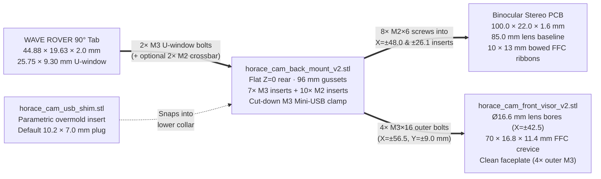

# Stage 3 · Binocular depth <span class="htc-badge htc-badge--progress">In progress · CAD v2.3 ready</span>

Give horace its eyes: a binocular (stereo) camera (`100.0 × 22.0 × 1.6 mm` PCB, **85.0 mm** stereo baseline) computing depth and streaming rectified stereo / point clouds, housed in a custom 3D-printable retro visor mount (`v2.3`) designed around **M3 & M2 brass heat-set threaded inserts** and bolted to the upturned 90° front tab of the WAVE ROVER expansion plate.

## Goals

- [x] Measure the stereo camera PCB (`100.0 × 22.0 × 1.6 mm`, **85.0 mm** lens baseline, `96.0 × 18.0 mm` corner holes, `52.2 × 18.0 mm` middle holes, `10 × 13 mm` bowed FFC ribbons) and the WAVE ROVER 90° upturned front bracket
- [x] Design support-free 3D-printable stereo camera enclosure (`horace_cam_back_mount_v2.stl` + `horace_cam_front_visor_v2.stl`) with M3/M2 heat-set insert bosses, `96 mm` structural gusset wings, `12.8 mm` FFC ribbon protection crevice, and Mini-USB strain-relief clamp (`horace_cam_usb_shim.stl`)
- [ ] Print the 3-piece camera housing, press in M3 & M2 heat-set inserts, bolt to the 90° front tab, and verify Mini-USB plug retention
- [ ] Camera driver publishing rectified left/right images, camera info, and a depth image
- [ ] `depth_image_proc` producing a colored point cloud on `/points`
- [ ] Streams viewable live in Foxglove / RViz on the Mac over WiFi

---

## 3D-printable stereo camera enclosure & mount (`cad/camera_mount/` · v2.3)

The WAVE ROVER's black anodized metal expansion plate features a **90° upturned front tab** (`44.88 mm` wide × `19.63 mm` tall above the top deck, `2.00 mm` thick) with two `Ø 2.3 mm` top-bar holes (`20.0–21.0 mm` center-to-center), two **"half-square" notches** (`X = ±7.45 mm`), and a **`25.75 × 9.30 mm` central U-window**. Meanwhile, the binocular stereo camera module is a **`100.0 × 22.0 × 1.6 mm` PCB** with two M12 lens barrels at an **`85.0 mm` center-to-center baseline** (`X = ±42.5 mm, Y = 0.0 mm`), exposed FFC ribbon loops that bow **`10.0 mm` high × `13.0 mm` wide** on the front face, and a downward-facing **Mini-USB receptacle** dead-center on the bottom edge (`X = 0.0 mm`).

After iterative fit-checking in Onshape, we designed the **v2.3 three-part, 100% support-free 3D-printable enclosure** around **M3 and M2 brass heat-set threaded inserts** (zero hex-nut pockets, 100% flat `Z = 0.0 mm` build-plate faces) in [`cad/camera_mount/`](https://github.com/palolz/horaceTheCheese/tree/main/cad/camera_mount):

<p>
  <a class="htc-btn htc-btn--red" href="../../assets/cad/horace_cam_back_mount_v2.stl" download>⬇ Back Cover v2.3 (.stl)</a>
  <a class="htc-btn" href="../../assets/cad/horace_cam_front_visor_v2.stl" download>⬇ Front Visor v2.3 (.stl)</a>
  <a class="htc-btn htc-btn--yellow" href="../../assets/cad/horace_cam_usb_shim.stl" download>⬇ Mini-USB Shim (.stl)</a>
  <a class="htc-btn" href="../../assets/cad/generate_camera_mount.py" download>⬇ Parametric Script (.py)</a>
</p>

| File | Dimensions (`X × Y × Z`) | Volume / Est. Mass | Role |
| --- | --- | --- | --- |
| [`horace_cam_back_mount_v2.stl`](../assets/cad/horace_cam_back_mount_v2.stl) | `122.2 × 42.4 × 18.8 mm` | `32.29 cm³` (~39 g) | Rear structural shell with `101.2 × 23.2 mm` PCB pocket, **8× M2 board heat-set insert bosses** (`X = ±48.0` & `±26.1 mm, Y = ±9.0 mm`), **4× outer M3 casing ears** (`X = ±56.5, Y = ±9.0 mm`), `96 mm` triangular gusset wings, 90° bracket M3/M2 insert bores, and cut-down **M3 Mini-USB pinch clamp** |
| [`horace_cam_front_visor_v2.stl`](../assets/cad/horace_cam_front_visor_v2.stl) | `122.2 × 29.6 × 16.8 mm` | `31.38 cm³` (~38 g) | Retro binocular front cover with **`85.0 mm` lens baseline (`X = ±42.5, Y = 0.0 mm`)**, `Ø 16.6 mm` lens bores, enlarged **`70.0 × 16.8 mm` FFC ribbon crevice** (`12.8 mm` height above PCB), **clean front faceplate** (4× outer M3 holes only), and **8× blind underside M2 screw-head pockets** |
| [`horace_cam_usb_shim.stl`](../assets/cad/horace_cam_usb_shim.stl) | `13.7 × 8.7 × 14.0 mm` | `0.67 cm³` (~1 g) | Quick-swap parametric U-collar insert sized for a `10.2 × 7.0 mm` Mini-USB overmold + `Ø 4.5 mm` cable neck (prints in 2 minutes) |



---

## Verified v2.3 dimensions & Onshape fit refinements

We combined factory **`WAVE_ROVER-EP_DXF`** geometry and 5×5 mm grid photogrammetry (`P1044915.JPG`–`P1044931.JPG`) with direct physical caliper & Onshape checks on the camera module:



| Component / Feature | Verified v2.3 Value | Fit & Clearance Notes |
| --- | --- | --- |
| **Stereo PCB width × height × thickness** | **`100.0 × 22.0 × 1.6 mm`** | Cradled inside a **`101.2 × 23.2 mm` pocket** (`X = ±50.6 mm, Y = ±11.6 mm`, **`0.6 mm` clearance per side** in both X and Y) with a `98.0 × 18.0 × 1.4 mm` rear SMD recess over a `5.4 mm` solid floor. |
| **Stereo lens baseline (center-to-center)** | **`85.0 mm`** (`X = ±42.5 mm, Y = 0.0 mm`) | Centered at `11.0 mm` across the `22.0 mm` height (`Y = 0.0 mm`) and `7.5 mm` inset from the `100.0 mm` ends. Each `14.0 × 14.0 × 6.0 mm` M12 lens base sits inside a `15.2 × 15.2 mm` internal visor pocket with a `Ø 16.6 mm` through-bore (`Ø 18.2 mm` chamfered bezel). |
| **8× PCB M2 heat-set insert bores (`Back Cover`)** | **`Ø 3.2 mm × 4.5 mm` deep** (`Ø 3.8 mm` 45° lead-in, `Ø 6.0 mm` boss) | **4× Outer corner holes** at **`96.0 × 18.0 mm` (`X = ±48.0, Y = ±9.0 mm`, exact `2.0 mm` edge inset)** + **4× Middle holes (3rd from left/right)** at **`52.2 × 18.0 mm` (`X = ±26.1, Y = ±9.0 mm`)**. Blind from `Z = 6.8 mm` down to `Z = 2.3 mm` (`2.3 mm` solid sealed rear floor). |
| **4× Outer M3 casing fastening ears (`Back + Visor`)** | **`113.0 × 18.0 mm`** (`X = ±56.5, Y = ±9.0 mm`, `Ø 9.2 mm` boss OD) | Positioned completely outside the `101.2 mm` PCB pocket (inner boss edge at `X = ±51.9 mm`). Back Cover has `Ø 4.0 × 6.5 mm` M3 insert bores; Front Visor has `Ø 3.4 mm` through-holes + `Ø 6.5 mm` counterbores. |
| **Clean front faceplate + 8× blind M2 head pockets (`Visor`)** | **0 PCB through-holes on front face**; **8× `Ø 4.8 × 2.8 mm` blind pockets** underneath | Only the 2 lens bores and 4 outer M3 bolts appear on the front face. Underneath (`Z = 0.0 mm`), 8× blind `Ø 4.8 mm` pockets (with 45° conical roofs) provide **`4.2 mm` of vertical clearance** above the PCB for the M2 screw heads. |
| **Enlarged FFC ribbon protection crevice (`Visor`)** | **`70.0 × 16.8 mm` wide × `12.8 mm` height above PCB** (`11.4 mm` visor depth + `1.4 mm` lip) | Clears the two **`10.0 mm` high × `13.0 mm` wide** bowed FFC ribbon cables with `1.9 mm` lateral clearance per side and `2.8 mm` vertical air gap beneath a `3.1 mm` solid roof. |
| **90° bracket M3 & M2 insert interface (`Back Cover`)** | **2× M3 (`Ø 4.0 × 6.5 mm` at `X = ±10.0, Y = -15.1 mm`)** + **2× M2 (`Ø 3.2 × 4.5 mm` at `X = ±10.25, Y = -7.75 mm`)** | Allows bolting straight through the metal bracket's `25.75 × 9.30 mm` U-window into **2× M3 heat-set inserts** (plus 2× M2 crossbar bores and 2× `Ø 2.8 mm` notch alignment sockets at `X = ±7.45, Y = -8.80 mm`). |
| **Cut-down Mini-USB clamp collar (`Back Cover`)** | Raised collar starts at **`Y ≤ -16.2 mm`** (`1.4 mm` clear of Front Visor's `Y = -14.8 mm` wall) | USB neck channel (`Y = -16.2..-11.6 mm`) is cut down to `Z = 6.4 mm` so it never touches the Front Visor (`0.000000 mm³` boolean interference). Right jaw houses an **M3 heat-set insert (`Ø 4.0 mm`)** opposite an `Ø 3.4 mm` bolt bore on the left jaw. |

---

## Detailed part drawings & 3D inspection sheets

### 1. Back Cover v2.3 (`horace_cam_back_mount_v2.stl`)





### 2. Front Visor v2.3 (`horace_cam_front_visor_v2.stl`)





### 3. Workbench measurement reference photos (5×5 mm grid)

<div class="htc-photo-grid">
  <figure class="htc-photo">
    
    <figcaption><strong>Expansion plate (`P1044915`):</strong> Black anodized top deck on the 5×5 mm cutting mat with the 90° upturned camera bracket at the front.</figcaption>
  </figure>
  <figure class="htc-photo">
    
    <figcaption><strong>90° upturned front tab (`P1044916`):</strong> The two mounting holes at the 25 mm and 45 mm grid lines (~20–21 mm spacing) and the two inner "half-square" notches flanking the center bridge.</figcaption>
  </figure>
  <figure class="htc-photo">
    
    <figcaption><strong>Stereo camera front (`P1044927`):</strong> <code>100.0 × 22.0 mm</code> PCB, <code>85.0 mm</code> lens center-to-center baseline, bowed blue/white FFC ribbons (<code>10 × 13 mm</code>), 12× M2 holes, and bottom-center Mini-USB port.</figcaption>
  </figure>
  <figure class="htc-photo">
    
    <figcaption><strong>Top-edge profile (`P1044928`):</strong> <code>1.6 mm</code> PCB, <code>14 × 14 mm</code> M12 lens holders, <code>19.0 mm</code> total lens + cap height, and rear SMD clearance.</figcaption>
  </figure>
</div>

---

## Mechanical architecture & heat-set insert assembly



1. **Why M3 & M2 heat-set inserts (and why M5 is too large):**
   - The `100.0 × 22.0 mm` camera PCB has `Ø 2.0 mm` mounting holes just `2.0 mm` from its edges, and the metal 90° bracket crossbar is only `4.22 mm` tall — an M5 screw (`Ø 5.0 mm`) or M5 insert (`Ø 6.4 mm` bore) is wider than both features.
   - Instead, **4× beefy outer M3 ears (`X = ±56.5, Y = ±9.0 mm`, `113.0 × 18.0 mm` C-to-C)** sit outside the `101.2 mm` PCB pocket to clamp the Front Visor to the Back Cover with standard **M3 brass heat-set inserts (`Ø 4.0 × 6.5 mm` bore)**, while **8× M2 heat-set insert bosses (`Ø 3.2 × 4.5 mm` bore)** at `X = ±48.0 mm` (corners) and `X = ±26.1 mm` (3rd holes from left/right) secure the PCB directly to the Back Cover shelf.
2. **100% flat `Z = 0.0 mm` support-free printing & `96 mm` structural gussets:**
   - All rear hex-nut pockets were eliminated in v2.3: the entire rear face of `horace_cam_back_mount_v2.stl` sits dead-flat on `Z = 0.0 mm` with a `6.8 mm` baseplate (`5.4 mm` solid floor beneath the SMD pocket), sweeping `96.0 mm` triangular gusset wings, and raised diagonal stiffening ribs.
   - Every internal cavity in `horace_cam_front_visor_v2.stl` (the `70.0 × 16.8 × 11.4 mm` FFC ribbon chamber, `15.2 × 15.2 mm` lens-base pockets, `8×` blind M2 screw-head pockets, and Mini-USB arch) terminates in a **45° self-supporting vaulted/conical roof**, so all three STLs print flat on `Z = 0.0 mm` with **Supports: Disabled**.
3. **Customizing the Mini-USB plug shim in 2 seconds:**
   ```bash
   /opt/homebrew/Caskroom/miniforge/base/envs/ros_jazzy/bin/python3 \
     cad/camera_mount/generate_camera_mount.py \
     --lens-baseline 85.0 \
     --usb-plug-width 10.2 \
     --usb-plug-depth 7.0 \
     --usb-cable-dia 4.5
   ```

---

## Next steps: ROS 2 stereo depth pipeline

1. Print `horace_cam_back_mount_v2.stl`, `horace_cam_front_visor_v2.stl`, and `horace_cam_usb_shim.stl`, press in the M3 and M2 brass heat-set inserts, bolt to the expansion plate's 90° front tab, and record the static transform `base_link → camera_link`.
2. Calibrate the `85.0 mm` baseline stereo pair with `camera_calibration` and launch `stereo_image_proc` + `depth_image_proc` to publish `/points`.
3. Verify live point clouds in Foxglove / RViz over Wi-Fi while driving via `wave_rover_base`.
